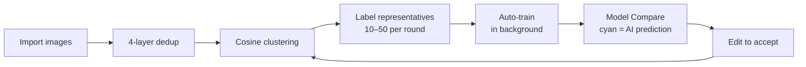

# KeenForge 2.0 — The AI Engineer for Your Own Datasets

[](https://opensource.org/licenses/MIT)
[](https://www.python.org/)
[](https://pytorch.org/)
[](https://github.com/KeenForgeAI/KeenForge)
[](README.zh-CN.md)

> **CVPR 2026 Demo Track — accepted** · Formerly AutoLabel Pro

**KeenForge** is a local-first desktop app that turns a folder of images into a trained
object-detection model — without writing a single line of code. Import images, let it
**deduplicate and cluster** them, label a handful of cluster representatives, and the model
trains itself in the background. Your data never leaves your computer.

<p align="center">
  
</p>

---

## Why we built KeenForge

In 2024, while reproducing papers, we noticed something rarely discussed: many SOTA numbers are
computed on public datasets with serious quality problems. The widely used **BCCD** blood-cell
dataset is a case in point — blurry frames, overlapping red cells that cannot be separated, and
missing boxes.

We rebuilt a curated **1,260-image** dataset (published in *Scientific Data*, 2025). On the
original BCCD a model plateaus below **92%**; on the curated version it reaches **98%+**.
**Data quality is the ceiling.**

Then we hit the next bottleneck: **annotation**. Tools like X-AnyLabeling help you *draw* boxes,
but they do not make labeling faster. In our own workflow we labeled ~250 images, trained
YOLOv8n, auto-labeled the remaining ~1,000, and did one human review pass. That
**human-in-the-loop** cycle is what actually saved time.

KeenForge started as **AutoLabel Pro** (CVPR 2026 Demo Track). In 2.0 we go further: not just an
annotation tool, but an **"AI engineer"** that helps an expert label a dataset *and* end up with
the best model.

> 📄 Our dataset-quality study: [*Scientific Data* (2025)](https://www.nature.com/articles/s41597-025-05980-z)

---

## What's New in 2.0

2.0 is not just a bigger 1.0 — it replaces "label everything" with a **closed active-learning loop**.

- 🧹 **Smart Data Cleaning** — 4-layer dedup (SHA-256 → perceptual hash → pixel MAE with ±2px shift alignment → semantic cosine) plus clustering that picks the most informative representatives.
- 🔁 **Cluster-Guided Active Learning** — label the representatives (**10–50 images per round**, not thousands) → auto-train → compare → **re-cluster at finer granularity** → repeat.
- 🔍 **Model Compare Mode** — run your trained model on *already-labeled* images. Predictions appear as **cyan dashed boxes with confidence**; human labels stay green. **Edit to accept** — un-reviewed predictions can never overwrite ground truth.
- ⚖️ **Bring-Your-Own Weights** — resume from any `.pt` / `.pth`; transfer / recursive / from-scratch strategies.
- ⚡ **Non-Blocking Training** — training runs in a separate process; keep labeling while it trains.
- 📊 **Training Summary** — per-class bounding-box statistics, mAP over rounds, model files.
- 🌏 **Full zh / en UI** — switch language at runtime.
- 🛡️ **Robust I/O** — decodes images by content, so mislabeled extensions (`.png` files that are really JPEG) just work.

---

## How It Works (the loop)



Label the representatives of each cluster, not the whole dataset. The model trains, predicts the
next clusters, and you only correct what it gets wrong — a strong niche-domain model from a
fraction of the annotation budget.

---

## See it in action

### 1. Clean the data first

<p align="center">
  
</p>

Exact, perceptual, geometric and semantic duplicates are found automatically — including a pair
shifted by only **2 pixels** (MAE 10.14 → 2.57 after alignment).

### 2. Label representatives, not everything

<p align="center">
  
</p>

Cosine clustering selects the most informative representatives. You label **10–50 per round**.

### 3. Train in the background

<p align="center">
  
</p>

Training runs in a separate process — keep labeling, clustering and reviewing while it trains.

### 4. Compare, correct, repeat

<p align="center">
  
</p>

**Cyan dashed boxes** are model predictions with confidence; **green boxes** are human labels.
Edit to accept — predictions never overwrite your ground truth. Here: 10 human labels, 868
images still pending, and the model already proposes RBC/WBC boxes at 0.82–0.97 confidence.

---

## Results

On our blood-cell dataset (**1,275 images · 3 classes · 23,745 boxes**): 12 rounds, best
**mAP50 = 0.993** at round 6. The full label → train → re-label loop is recorded in the training
summary.

<p align="center">
  
</p>

---

## Why KeenForge?

| | Roboflow | Label Studio | **KeenForge 2.0** |
|---|---|---|---|
| **Deployment** | Cloud (data uploaded) | Docker (complex setup) | **One-click launcher** |
| **Data Privacy** | ❌ Images leave your machine | ⚠️ Self-hosted but heavy | ✅ **100% local, offline** |
| **Data Cleaning** | Paid tier | ❌ None | ✅ **Built-in 4-layer dedup + clustering** |
| **Active Learning** | ❌ None | ❌ None | ✅ **Cluster-guided loop** |
| **AI Assistance** | Paid tier | Manual config | ✅ **YOLO-World zero-shot** |
| **Auto-Training** | Paid GPU credits | ❌ None | ✅ **Auto-triggers on cluster-rep quota** |
| **Model Ownership** | ❌ Locked to platform | ✅ Open source | ✅ **You own your model** |
| **Price** | $79–$249/mo | Free (self-host) | **Free & Open Source** |

---

## What Can You Do With It?

- **Industrial QC**: detect scratches, dents, or soldering defects on a production line
- **PCB / materials**: inspect surface defects where public models simply don't exist
- **Medical / microscopy**: count and classify cells, particles and tissue regions
- **Safety Monitoring**: detect helmets, vests, or unsafe behavior in workplace footage
- **Research**: build custom datasets for papers — export to COCO, VOC, or YOLO
- **Anything you can see**: if you can draw a box around it, KeenForge can learn to find it

---

## Quick Start (3 minutes)

### Option 1: One-click launcher (small download, auto-installs the environment)

Download `KeenForge-2.0.0-source.zip` from [Releases](https://github.com/KeenForgeAI/KeenForge/releases), unpack it, then:

- **Windows**: double-click `run_windows.bat`
- **Linux / macOS**: `./run_unix.sh`

The launcher creates a local `.venv`, installs the dependencies automatically on first run
(a few minutes), then starts KeenForge. The heavy PyTorch/Ultralytics stack is fetched on your
machine instead of being bundled, so the download stays small.

Then:

1. Load your image folder
2. Run **Deduplicate** and **Group Similar** from the toolbar
3. Label the cluster representatives → the model auto-trains on the round quota
4. Turn on **Model Compare (cyan)** to review and correct predictions → repeat

### Option 2: Manual (from source)

```bash
git clone https://github.com/KeenForgeAI/KeenForge.git
cd KeenForge
pip install -r requirements.txt
python src/main.py
```

**Prerequisites**: Python 3.8+ · CUDA optional (works on CPU, GPU strongly recommended for training).
On Windows, `pip install torch` installs the CPU build; for NVIDIA GPUs use
`pip install torch torchvision --index-url https://download.pytorch.org/whl/cu121`.

---

## Core Features

### 4-Layer Deduplication

1. **Byte level** — SHA-256 exact duplicates.
2. **Perceptual level** — PDQHash 256-bit (pHash 64-bit fallback) across **8 dihedral orientations**, compared by Hamming distance.
3. **Geometric level** — pixel-level MAE (minimum over 8 transforms) with **±2px shift alignment**.
4. **Semantic level** — MobileNetV3 / ResNet50 embeddings, L2-normalized cosine similarity.

Real-world result on GC10-DET (2,306 images): exactly **13 true duplicate groups**, including a pair
that only differs by a 2-pixel shift (MAE 10.14 → **2.57** after alignment).

### Cosine Clustering & Representatives

Images are embedded and clustered. KeenForge picks one representative per cluster to cover the
data, clamped to **10–50 representatives per round** — a coverage-driven quota instead of a rigid
percentage.

### Zero-Shot Bootstrap (YOLO-World)

Type any object name — `"welding defect"`, `"safety helmet"`, `"ripe tomato"` — and KeenForge finds
it immediately. Zero-shot recall has a ceiling (~85–90% in our tests); the first training round
breaks through it.

### Model Zoo

| Model | Use case |
|---|---|
| YOLOv8n/s/m/l/x | General object detection |
| YOLO11n/s/m/l/x | Latest YOLO architecture |
| RT-DETR-l/x | Real-time transformer detection |
| YOLO-World v2 (s/m) | Zero-shot open-vocabulary |
| Faster-RCNN | High accuracy, slower |
| RetinaNet | Dense object scenes |
| SSD300 | Lightweight, fast |

### Format Support

- **Import**: COCO JSON, Pascal VOC XML
- **Export**: COCO JSON, Pascal VOC XML, YOLO TXT
- **Training output**: standard Ultralytics `.pt` weights

---

## Datasets for Niche Domains

Target detection is easy to *showcase* on COCO and hard to *deploy* everywhere else. We curate and
publish **corrected, ready-to-use** datasets — deduplicated, re-split, format-fixed:

**NEU-DET · GC10-DET · DeepPCB · PKU-Market-PCB · TXL-PBC · MagneticTile · PlantDoc · PCB_AoI · Raccoon**

→ [huggingface.co/KeenForgeAI](https://huggingface.co/KeenForgeAI) · index: [KeenForgeData](https://github.com/KeenForgeAI/KeenForgeData)

> If you download one of these datasets, KeenForge is the tool they were cleaned with.

---

## Keyboard Shortcuts

| Key | Action |
|---|---|
| `A` / `D` | Previous / Next image (auto-saves) |
| `R` | Toggle Draw / Edit mode |
| `J` | Move to Junk folder |
| `Ctrl+Z` | Undo |
| `Ctrl+C/V` | Copy / Paste boxes |
| `Ctrl+D` | Duplicate selected box |
| `Delete` | Remove selected box |
| `Middle-click + drag` | Pan canvas |
| `Ctrl + Scroll` | Zoom |

---

## Roadmap 2.x

- [x] Dataset deduplication (4-layer)
- [x] Cosine clustering + representative selection
- [x] Cluster-guided active learning loop
- [x] Model compare mode (edit-to-accept)
- [x] Bring-your-own weights
- [ ] SAM-powered segmentation (polygon masks)
- [ ] Adaptive fine-tuning tuned for YOLO
- [ ] One-click API deployment
- [ ] `pip install` support

**Want to help?** Check the [Issues](https://github.com/KeenForgeAI/KeenForge/issues) tab for `good first issue` tasks.

---

## Community & Contributing

We want KeenForge to be shaped by the people who actually label niche datasets.

- ⭐ **Star** the repo if it is useful
- 🐛 **Report bugs** — especially on your own dataset/format; a failing sample is gold to us
- 💡 **Ideas & questions** — open a Discussion or Issue
- 🔧 **Contribute** — UI/UX, new model integrations, docs translation (zh ↔ en)

1. Fork the repo
2. Create a branch: `git checkout -b feature/your-feature`
3. Commit your changes
4. Push and open a Pull Request

---

## Citation

If KeenForge helps your research, please cite:

```bibtex
@misc{keenforge2026,
  title={KeenForge: No-Code Desktop Tool for Expert-Led Object Detection Model Training},
  author={Lu Gan and Xi Li},
  year={2026},
  howpublished={\url{https://github.com/KeenForgeAI/KeenForge}},
  note={CVPR 2026 Demo Track}
}
```

---

## License

MIT License — Copyright (c) 2026 KeenForgeAI. Free for open source and commercial use. See [LICENSE](LICENSE) for details.

---

<p align="center">
  <b>⭐ Star this repo if you find it useful!</b><br>
  <sub>Built with ❤️ by <a href="https://github.com/KeenForgeAI">KeenForgeAI</a></sub>
</p>
